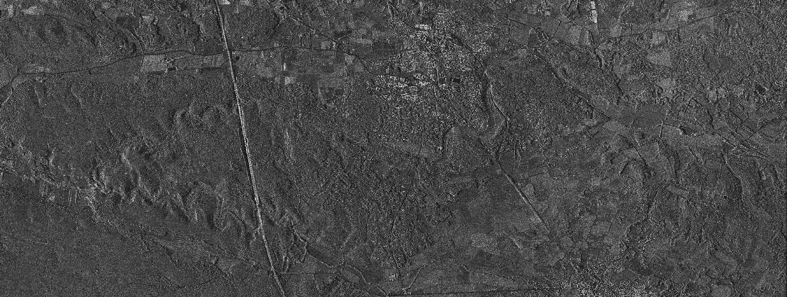
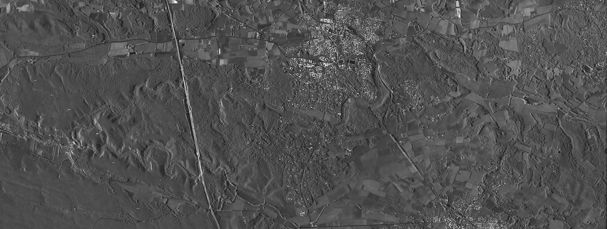
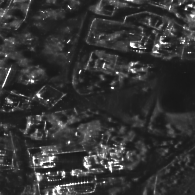
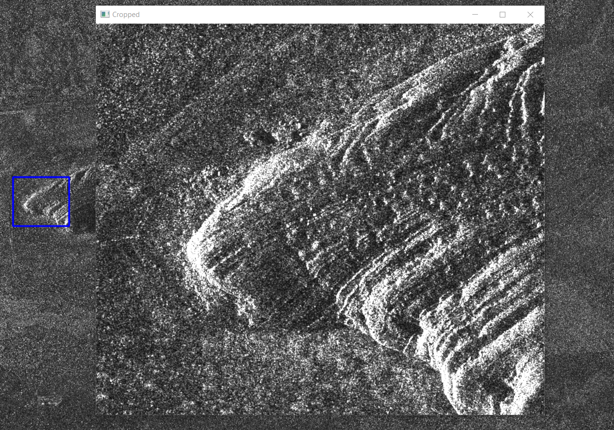
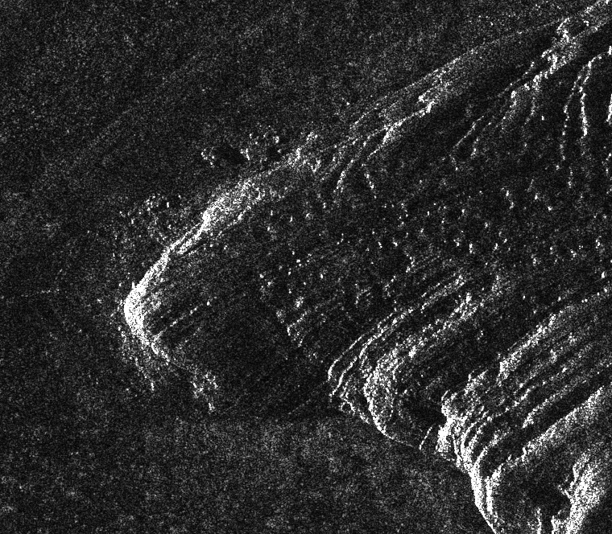
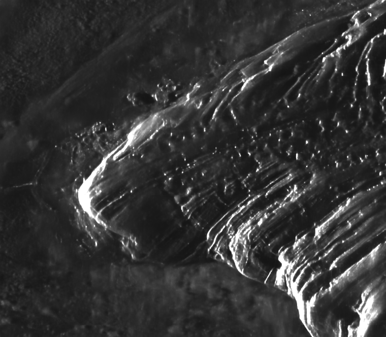
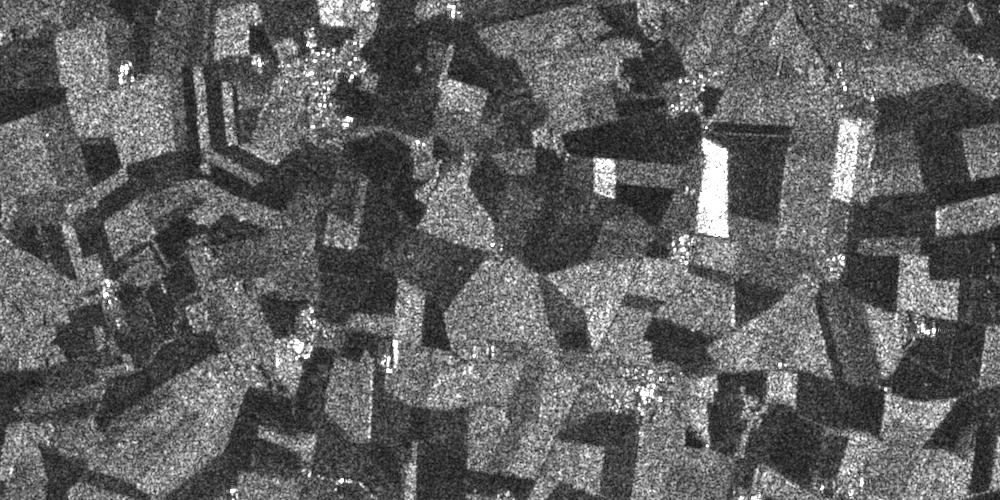

# deepdespeckling 

Speckle noise seriously limits the interpretability of synthetic aperture radar (SAR) images. This package provides <strong>deep learning based despeckling methods</strong> to denoise SAR images. 

<strong>deepdespeckling</strong> gives access to two different despeckling methods: 

* [MERLIN](https://arxiv.org/pdf/2110.13148.pdf) 
* [SAR2SAR](https://arxiv.org/pdf/2006.15037.pdf) 


[](https://badge.fury.io/py/deepdespeckling)
[](https://opensource.org/licenses/MIT)
[](https://hi-paris.github.io/deepdespeckling/)

## Installation

### 1. Installation with conda
Before installing deepdespeckling, make sure to install gdal dependancies, it can be done using conda with the following command : 
```
conda install -c conda-forge gdal
```

Then, deepdespeckling can be installed simply using pip :

```python
pip install deepdespeckling
```

### 2. Installation with Docker
Depending on your infrastructure, if it supports Docker, you can setup a docker environment with `python:3.10` and the dependencies in `requirements.txt` with these steps: 
- 1. Build a Docker image:
```
docker-compose build   
```

- 2. Run the docker container:
```
docker-compose up
```
Once the container is running, you can access to the JupyterLab by opening your browser: 
```
http://127.0.0.1:8888/lab
```

The mounted volumes from your local machine to the docker container are:
- Project root: `.`:`/app/`
- Main code: `/app/deepdespeckling/`
- Data: `./data`:`/app/data/`
- Notebooks: `./notebooks`:`/app/notebooks/`

Notebooks:
- `tutorial_notebook.ipynb`: contains the different usage of the models.
- `generate_test_images.ipynb`: helps to generate fake images to test the logic of `generate_test_images.ipynb`. 


- 3. Once, you finish your work, stop the container and remove the attached volumes with: 
```
docker-compose down -v
```

⚠️ Warning: If your infrastructure (e.g. HPC clusters, shared servers, or corporate machines) does not support Docker, you will not be able to use this setup.
In that case, you can use a virtual environment or Conda to manually install dependencies from `requirements.txt`.


## Inference with MERLIN

To despeckle SAR images using MERLIN, images need to be in `.cos` or `.npy` format.

In order to get the right model, the `model_name` has to be specified when building a `MerlinDenoiser`.

This `model_name` can either be :
- `"spotlight"` for SAR images retrieved with spotlight mode 
- `"stripmap"` for SAR images retrieved with stripmap mode
- `"Sentinel-TOPS"` for SAR images retrieved with TOPS mode


During the preprocessing steps of the noisy image for MERLIN, the real and the imaginary parts are <strong>"symetrised"</strong> (to match the theoretical assumptions of MERLIN). To skip this step, you can set the `symetrise` parameter to `False`


### Despeckle one image with MERLIN

```python
from deepdespeckling.utils.load_cosar import cos2mat
from deepdespeckling.utils.constants import PATCH_SIZE, STRIDE_SIZE
from deepdespeckling.merlin.merlin_denoiser import MerlinDenoiser

# Path to one image (cos or npy file)
image_path="path/to/image"
# Model name, can be "spotlight", "stripmap" or "Sentinel-TOPS"
model_name = "spotlight"
symetrise = True

image = cos2mat(image_path).astype(np.float32)
# As an alternative, you can load your image by being sure to put in the following format:
# The shape of image is [img_height,img_width,2], where image[:,:,0] contains the real part and image[:,:,1] contains the imaginary part of the SLC SAR image.

denoiser = MerlinDenoiser(model_name=model_name, symetrise=symetrise)
denoised_image = denoiser.denoise_image(image, patch_size=PATCH_SIZE, stride_size=STRIDE_SIZE)
```

### Despeckle a set of images using MERLIN

For each of this method, you can choose between 3 different functions to despeckle a set of SAR images contained in a folder : 

* `despeckle()` to despeckle full size images
* `despeckle_from_coordinates()` to despeckle a sub-part of the images defined by some coordinates
* `despeckle_from_crop()` to despeckle a sub-part of the images defined using a crop tool

#### Despeckle fullsize images

```python
from deepdespeckling.despeckling import despeckle

# Path to a folder of several images (cos or npy files)
image_path="path/to/image"
# Folder where results are stored
destination_directory="path/where/to/save/results"

despeckle(image_path, destination_directory, model_name="spotlight", symetrise=True)
```
Noisy image             |  Denoised image
:----------------------:|:-------------------------:
  |  

#### Despeckle parts of images using custom coordinates

```python
from deepdespeckling.despeckling import despeckle_from_coordinates

# Path to a folder of several images image (cos or npy files)
image_path="path/to/cosar/image"
# Folder where results are stored
destination_directory="path/where/to/save/results"
# Coordinates of the subparts of the images to be despeckled
coordinates_dictionnary = {'x_start':2600,'y_start':1000,'x_end':3000,'y_end':1200}

despeckle_from_coordinates(image_path, coordinates_dict, destination_directory, model_name="spotlight", symetrise=True)
```

Noisy image             |  Denoised image
:----------------------:|:-------------------------:
  |  

#### Despeckle parts of images using a crop tool

```python
from deepdespeckling.merlin.inference.despeckling import despeckle_from_crop

# Path to a folder of several images image (cos or npy files)
image_path="path/to/cosar/image"
# Folder where results are stored
destination_directory="path/where/to/save/results"
fixed = True "(it will crop a 256*256 image from the position of your click)" or False "(you will draw free-handly the area of your interest)"

despeckle_from_crop(image_path, destination_directory, model_name="spotlight", fixed=False, symetrise=True)
```

* The cropping tool: Just select an area and press "q" when you are satisfied with the crop !

<p align="center">
  
</p>

* The results:

Noisy cropped image                     |           Denoised cropped image
:-----------------------------------------------------------:|:------------------------------------------:
  | 

## Inference with SAR2SAR for Sentinel-1 Ground Range Detected (GRD) images

To despeckle Sentinel-1 GRD SAR images using SAR2SAR, images need to be in `.tiff` or `.npy` format.


### Despeckle one image with SAR2SAR

```python
from deepdespeckling.utils.load_cosar import cos2mat
from deepdespeckling.utils.constants import PATCH_SIZE, STRIDE_SIZE
from deepdespeckling.sar2sar.sar2sar_denoiser import Sar2SarDenoiser

# Load you image
image = ..
# NB: image must be in AMPLITUDE format and have the following shape: [img_height,img_width]

# Denoise the image with SAR2SAR
denoiser = Sar2SarDenoiser()
denoised_image = denoiser.denoise_image(
                image, patch_size=PATCH_SIZE, stride_size=STRIDE_SIZE)
```

- Example of result with SAR2SAR :


Noisy image             |  Denoised image
:----------------------:|:-------------------------:
  |  


### Despeckle a set of images using SAR2SAR

The despeckling functions (`despeckle, despeckle_from_coordinates, despeckle_from_crop`) work the same as with MERLIN. To use SAR2SAR, the `model_name` parameter has to be set to `"sar2sar"`

For example, to despeckle a set of fullsize images:
```python
from deepdespeckling.despeckling import despeckle

# Path to a folder of several images (tiff or npy files)
image_path="path/to/image"
# Folder where results are stored
destination_directory="path/where/to/save/results"

despeckle(image_path, destination_directory, model_name="sar2sar")
```

## Documentation

The documentation of the package is [available here](https://hi-paris.github.io/deepdespeckling/)

## Authors

* [Emanuele Dalsasso](https://emanueledalsasso.github.io/) (Researcher at ECEO, EPFL)
* [Hadrien Mariaccia](https://www.linkedin.com/in/hadrien-mar/) (Hi! PARIS Research Engineer)

## Former contributors 

* [Youcef Kemiche](https://www.linkedin.com/in/youcef-kemiche-3095b9174/) (Former Hi! PARIS Research Engineer)
* [Pierre Blanchard](https://www.linkedin.com/in/pierre-blanchard-28245462/) (Former Hi! PARIS Research Engineer)


# References

[1] DALSASSO, Emanuele, DENIS, Loïc, et TUPIN, Florence. [As if by magic: self-supervised training of deep despeckling networks with MERLIN](https://arxiv.org/pdf/2110.13148.pdf). IEEE Transactions on Geoscience and Remote Sensing, 2021, vol. 60, p. 1-13.

[2] DALSASSO, Emanuele, DENIS, Loïc, et TUPIN, Florence. [SAR2SAR: a semi-supervised despeckling algorithm for SAR images](https://arxiv.org/pdf/2006.15037.pdf). IEEE Journal of Selected Topics in Applied Earth Observations and Remote Sensing (Early Access), 2020
